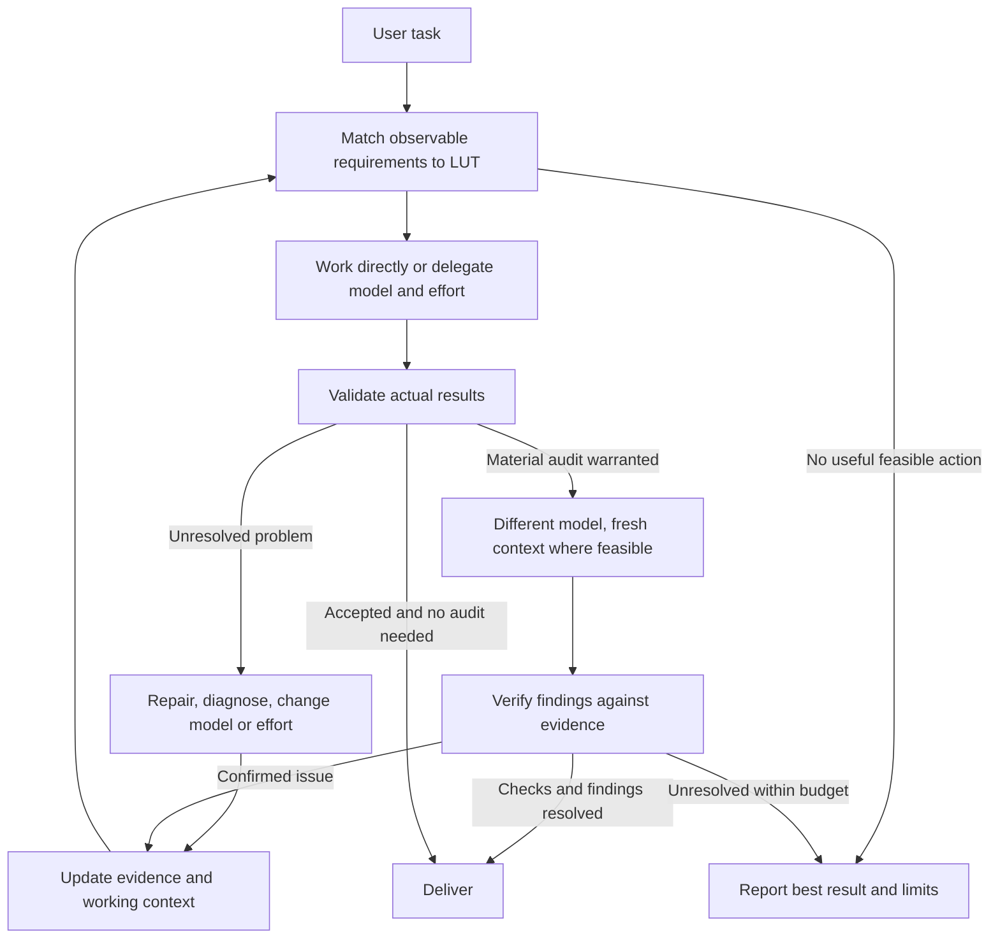

# AgentMD

A single global `AGENTS.md` for OpenAI Codex: **capability lookup + intentional cross-model adversarial verification + evidence-based context refinement**. The goal is the user's actual completed task, not benchmark collection or mandatory multi-agent discussion.

## Operating policy



All models are general-purpose. Choose model and reasoning effort together using the short LUT in [AGENTS.md](AGENTS.md), based on published workload guidance and benchmark evidence. Change models to improve capability **or** deliberately expose different errors. An auditor can be a lower-ranked model; disagreement or consensus is not proof. Verify counterexamples, remove refuted assumptions from the handoff, and retain independently supported work.

The default six substantive attempts is a shared prompt-level guardrail including local work, delegation, audit and repair. It is adjustable, not a proven optimum or a hard runtime quota. Routine tasks may complete in a single attempt.

## Files

- `AGENTS.md`: the sole AgentMD runtime instruction and LUT.
- `.codex/agents/agentmd_{luna,terra,sol,astra}.toml`: generic model selectors with a short common worker contract; no fixed effort or job.
- [research/benchmark-evidence.md](research/benchmark-evidence.md): offline evidence, methodology and limitations; not read during ordinary execution.
- [CONTRIBUTING.md](CONTRIBUTING.md): maintenance rules.

## Install

Back up existing global instructions and same-named agent definitions before copying; merge user-specific rules rather than unintentionally overwriting them. From the checkout:

```sh
export CODEX_HOME="${CODEX_HOME:-$HOME/.codex}"
mkdir -p "$CODEX_HOME/agents"
cp AGENTS.md "$CODEX_HOME/AGENTS.md"
cp .codex/agents/*.toml "$CODEX_HOME/agents/"
# Start with any supported model; for example:
codex --model gpt-6-luna
```

Model-specific Markdown files are no longer needed. If a previous installation contains them, the new instructions do not reference them. The global Markdown does not itself change the parent model. The generic TOMLs pin model identity; effort may be provided at spawn where supported. Actual model access, tool capabilities and effort resolution depend on the client and account. If switching the primary model is unavailable, use a supported subagent; do not pretend to switch. Fresh context and separate file-system isolation are not equivalent.

## Evidence and limits

The LUT combines official workload/effort recommendations with comparative benchmark observations as **working priors**, not calibrated success rates. No single score establishes every workload's best model; conditional rescue and audit accuracy for these four models are not established. Different models can share mistakes; multi-agent agreement is not verification. Cross-model audit is triggered by material risk and evidence needs, not a mandatory four-model cycle.

Status: configuration authored and available for static checking. End-to-end Codex model selection, context independence, enforcement of the attempt limit and quality improvements have **not** been demonstrated in the target runtime. Inspect actual logs and task acceptance checks before making claims.

Sources: [OpenAI model selection](https://developers.openai.com/api/docs/guides/model-selection), [Codex AGENTS.md](https://developers.openai.com/codex/guides/agents-md), [Codex subagents](https://developers.openai.com/codex/subagents), [benchmark registry](research/benchmark-evidence.md).

Unofficial community project.
