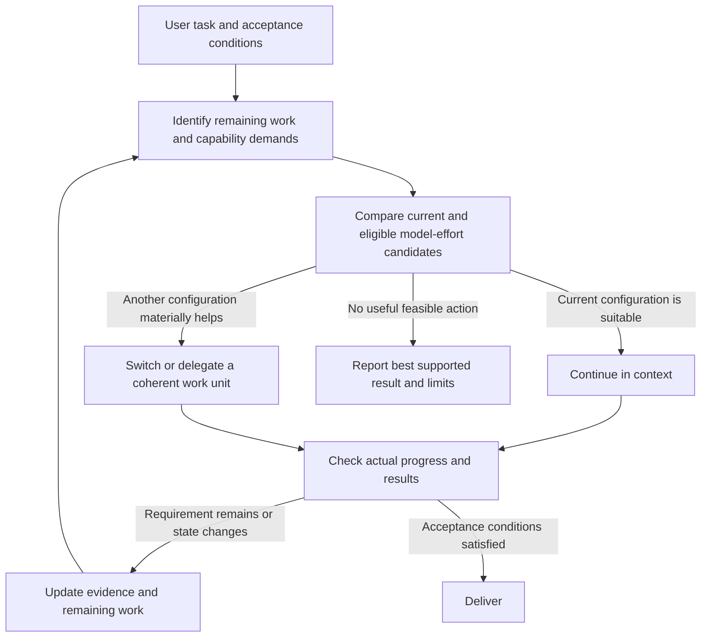

# AgentMD

A single global `AGENTS.md` for OpenAI Codex: **adaptive whole-task routing using model × reasoning-effort capability priors**. Complete the user's actual work with suitable models and minimize unnecessary calls, handoff and rework. No fixed model occupations, forced sequence or routine adversarial audit.

## Operating policy



The sparse LUT represents observable capability demands rather than an exhaustive list of task types. Multiple features may apply. Dated broad benchmark/resource data are only comparative priors; relevant task-specific evidence takes precedence. Choose the configuration for necessary work, not a permanent job assigned to a model. A task may use one model throughout, move between configurations, or return to a previous model. Keep related work together; consider total work, handoff and rework, not the cost of one call alone.

Ordinary verification is part of completing a task. Do not add a second agent just for audit, disagreement, consensus or diversity. If additional model-based verification is actually required to satisfy a material acceptance condition or requested by the user, route it like any other necessary work. Correct refuted assumptions during ordinary handoffs.

The default six substantive attempts is an adjustable shared prompt-level guardrail, not an optimized number or hard runtime quota. Do not count routine tool operations as new attempts.

## Files

- [AGENTS.md](AGENTS.md): sole AgentMD runtime instruction; sparse capability LUT, general comparison table, routing and stopping rules.
- `.codex/agents/agentmd_{luna,terra,sol,astra}.toml`: generic model selectors and short common worker contract; no fixed effort or occupation.
- [research/benchmark-evidence.md](research/benchmark-evidence.md): dated offline evidence, not routinely loaded by agents.
- [CONTRIBUTING.md](CONTRIBUTING.md): maintenance rules.

## Install

Back up existing instructions and same-named agents before copying; merge existing user-specific rules where necessary. From the repository checkout:

```sh
export CODEX_HOME="${CODEX_HOME:-$HOME/.codex}"
mkdir -p "$CODEX_HOME/agents"
cp AGENTS.md "$CODEX_HOME/AGENTS.md"
cp .codex/agents/*.toml "$CODEX_HOME/agents/"
# Start with a model actually available to your Codex client, for example:
codex --model gpt-6-luna
```

The global Markdown does not itself change the parent model or grant tools. The generic TOMLs select model IDs; request a supported effort at spawn where possible and check the actual resolved settings. If switching the parent is unavailable, delegate to an available worker when useful. If delegation is unavailable, work directly. Existing model-specific Markdown from older installations is not needed. Separate context does not guarantee separate file-system isolation.

## Evidence and limitations

The LUT uses archived workload guidance and comparative evaluations as working priors. An infinite range of task states cannot be represented by an exhaustive table. The feature-based policy generalizes to unseen tasks by matching observable demands, current progress and constraints; it does not know calibrated success probabilities or optimal routes. The broad table contains a dated 2026-11-24 snapshot, not a live benchmark feed or a Codex-plan cost estimate. No new performance measurements were made in this revision.

Static configuration consistency and end-to-end runtime behavior are different. Actual model/effort availability, instruction adherence, resource use and improved task quality remain unverified in the target client. The prior cross-model audit policy is superseded.

References: [OpenAI model selection](https://developers.openai.com/api/docs/guides/model-selection), [Codex AGENTS.md](https://developers.openai.com/codex/guides/agents-md), [Codex subagents](https://developers.openai.com/codex/subagents), [benchmark registry](research/benchmark-evidence.md).

Unofficial community project.
