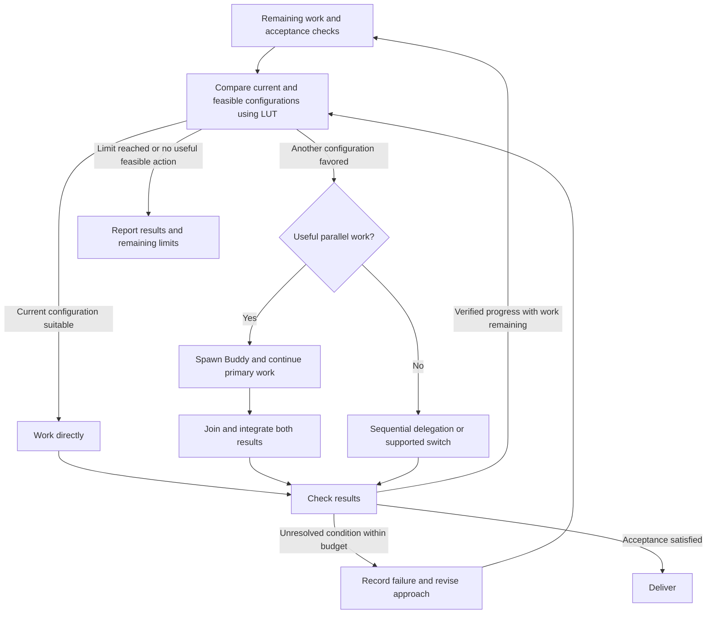

# AgentMD

One shared `AGENTS.md` for OpenAI Codex, with a **model × reasoning-effort lookup table and event-driven Buddy routing**. Finish the user's task with suitable configurations while accounting for quality, time, cost, context transfer and rework. All four models remain general-purpose.

## What it does



**Select using measured demands.** The shared LUT covers 22 model/effort configurations, eight AA component-quality rows, a broad index and other task-specific observations. Match the acceptance bottleneck and filter unsupported settings. For bounded work use official anchors or validated current progress; for demanding work prefer the relevant feasible observed quality peak provisionally, not as a proven optimum. Compare effort changes with model changes, including handoff and rework. Composite resource estimates are proxies; do not average incompatible metrics or interpret them as success probabilities.

**Buddy routing: work together.** When the existing LUT favors another model/effort for part of the task or a useful alternative approach, spawn it and continue your own useful work in parallel. Identify both outputs before launch: for example, the Buddy develops a fix while the primary checks integration and tests; or both independently analyze a consequential design decision. The Buddy can implement, investigate, reason or check, and has no fixed occupation. Do not wait immediately after spawning if useful work is available. Join at a dependency, compare and integrate both outputs against evidence, and update the working context before continuing. No mandatory first failure, permanent pair, extra Buddy LUT or always-on second opinion.

Use disjoint write ownership or isolated copies, or keep concurrent investigations read-only. If parallel progress is not useful or safe, work directly or delegate sequentially. A consequential decision with weak external verification can warrant independent collaboration even if the current model reports success. Ordinary checks are still required; model agreement alone is not evidence. A missing permission, tool or input requires an authorized remedy, not simply a stronger model.

**Transfer corrected state.** Preserve verified facts and their sources, the current artifact/checkpoint, hypotheses, refuted assumptions, open checks and the shared attempt ledger. Reuse a thread when that context helps; use a concise fresh handoff when obsolete reasoning would otherwise dominate. A worker's `PASS` label alone does not establish acceptance.

**Bound retries without stopping large tasks arbitrarily.** Unless the user specifies a different budget, allow at most **three substantive attempts on the same unresolved acceptance condition or blocker, including the initial attempt**. The primary reserves and counts attempts across local work, children and parallel candidates. If both Buddy and primary make independent solving attempts on the same condition, both count; distinct independently checkable subgoals have separate counts. Routine reads and checks within an attempt do not consume separate slots. Changing a model, renaming a blocker or proposing another hypothesis does not reset its count. A demonstrated checkpoint that resolves it can establish a genuinely new subgoal. Stop further attempts on an exhausted blocker and report it; continue independent useful work when feasible. This provisional design limit replaces the former six-attempt cap for the entire task. It is neither a measured optimum nor a hard runtime quota.

For example, implementing several independently checkable requirements is not limited to three total work units. Repeatedly trying to fix the same failing requirement is limited, even if each attempt uses another model.

## The eight files

| File | Purpose |
| --- | --- |
| [AGENTS.md](AGENTS.md) | Shared runtime policy, compact LUT, Buddy collaboration, handoff and stopping rules |
| [.codex/agents/agentmd_luna.toml](.codex/agents/agentmd_luna.toml) | `gpt-6-luna` binding |
| [.codex/agents/agentmd_terra.toml](.codex/agents/agentmd_terra.toml) | `gpt-6.1-terra` binding |
| [.codex/agents/agentmd_sol.toml](.codex/agents/agentmd_sol.toml) | `gpt-6.2-sol` binding |
| [.codex/agents/agentmd_astra.toml](.codex/agents/agentmd_astra.toml) | `gpt-6.2-astra` binding |
| [research/benchmark-evidence.md](research/benchmark-evidence.md) | Dated evidence and limitations; offline maintenance reference |
| [CONTRIBUTING.md](CONTRIBUTING.md) | Rules for maintaining the policy and evidence |
| [README.md](README.md) | Installation and explanation |

The four TOMLs share a short worker contract and leave effort unfixed. There are no model-specific Markdown policies. README, CONTRIBUTING and the evidence archive are not routine runtime reading requirements; the operational table is in AGENTS.md.

## Install and update

Use a local Codex client that supports standalone custom-agent TOMLs and the selected models. From the repository checkout, this POSIX-shell snippet performs a **first installation**. It stops if existing guidance or same-named agents would conflict, and it does not rewrite `CODEX_HOME`:

```sh
(
    set -euC
    agentmd_target="${CODEX_HOME:-$HOME/.codex}"

    for agentmd_rel in \
        AGENTS.override.md \
        AGENTS.md \
        agents/agentmd_luna.toml \
        agents/agentmd_terra.toml \
        agents/agentmd_sol.toml \
        agents/agentmd_astra.toml
    do
        if [ -e "$agentmd_target/$agentmd_rel" ] ||
           [ -L "$agentmd_target/$agentmd_rel" ]; then
            printf 'Existing guidance: %s\nBack up and merge before installing.\n' \
                "$agentmd_target/$agentmd_rel" >&2
            exit 1
        fi
    done

    test -f AGENTS.md
    for agentmd_family in luna terra sol astra; do
        test -f ".codex/agents/agentmd_$agentmd_family.toml"
    done

    mkdir -p "$agentmd_target/agents"
    cat AGENTS.md > "$agentmd_target/AGENTS.md"
    for agentmd_family in luna terra sol astra; do
        cat ".codex/agents/agentmd_$agentmd_family.toml" \
            > "$agentmd_target/agents/agentmd_$agentmd_family.toml"
    done
)
```

For an existing installation, save a backup of the affected files, compare them with this revision and merge the routing policy with your existing preferences. Preserve unrelated agent definitions and project rules. Review an existing `AGENTS.override.md` before deciding which guidance should be active; do not delete it merely to make installation pass. Keep a rollback copy. Restart Codex after installing or merging.

Start with a model available to your account, for example `codex --model gpt-6-luna`. Starting with Luna does not require it to attempt every work unit first.

## Loading and runtime settings

[Codex discovers guidance at startup](https://learn.chatgpt.com/docs/agent-configuration/agents-md): global instructions, then project-root-to-current-directory instructions. An applicable `AGENTS.override.md` takes precedence at its level; nearer project instructions take precedence over earlier guidance. The default combined limit is 32 KiB. Leave room for project instructions, and check loaded sources when the client exposes them.

[Custom agents](https://learn.chatgpt.com/docs/agent-configuration/subagents) live under the Codex home `agents/` directory or project `.codex/agents/`. Their configured model and effort take precedence over spawn settings. These files set only the model, preserving the effort already resolved from the spawn request, defaults or parent. Request the intended supported effort explicitly and check the resolved configuration. Model availability can differ between clients. The API catalog lists none for Luna and Terra, but not Sol and Astra; none is eligible only when supported by the actual Codex runtime.

Markdown does not grant tools, enforce budgets or change the parent model by itself. CLI users can choose an active model and supported effort with [`/model`, then inspect `/status`](https://learn.chatgpt.com/docs/developer-commands?surface=cli). Delegate when useful and supported; otherwise complete the best feasible work directly. Separate agent context does not guarantee separate writable files. Workers inherit the parent's permissions, so changing agents cannot bypass a blocker.

## Evidence and completion status

The LUT combines sparse capability guidance, an **AA Intelligence Index v5.0.2 and eight component scores for each of 22 model/effort configurations**, plus relevant Arena, FrontierCode, Terminal-Bench, search and science evidence. See the [registry](research/benchmark-evidence.md) for checked dates, exact settings and conditions. The scores describe different outcomes; they are not one common success scale. Missing measurements remain unknown. AA-derived generation-time estimates are not measured whole-task latency, and API costs are not Codex-plan usage.

This is a completed policy/configuration design, not proof of a universally optimal route. Static validation can establish syntax and consistency; successful loading, resolved model/effort, instruction adherence and quality gains require observation in the target client. No new model-performance measurements were made for this revision, and comparative performance remains unproven. Normal work does not trigger benchmark searches or experiments.

Unofficial community project.

