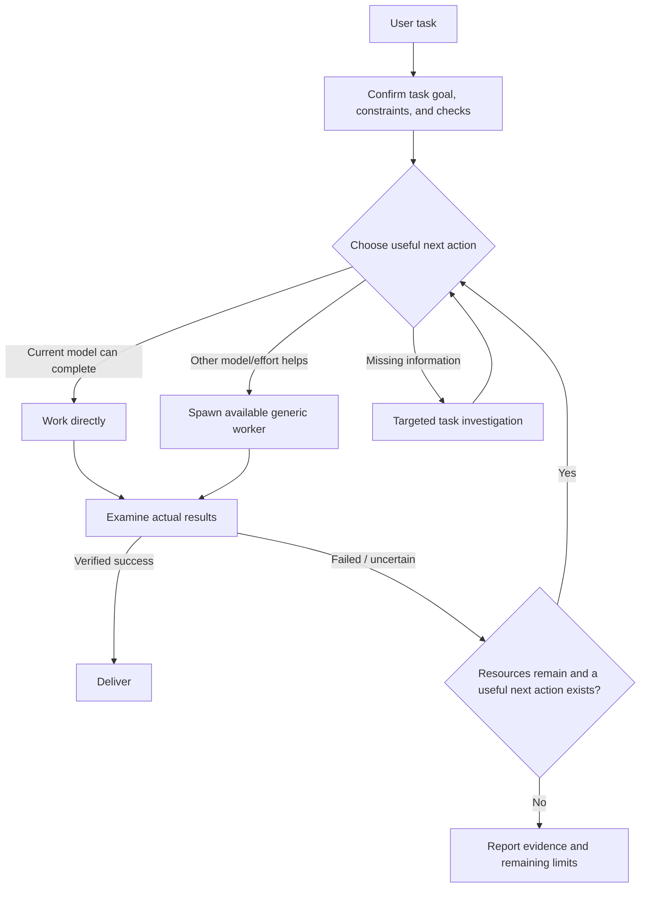

# AgentMD

**Purpose:** use OpenAI Codex to **complete ordinary user tasks** with the best available model/reasoning-effort combination and optional subagents. This is an operational routing policy, **not** a benchmark-collection workflow or agent prompt generator.

> Status (2026-11-25): configuration authored on GitHub; a full end-to-end Codex CLI run has **not** yet been verified. A natural-language AGENTS.md cannot guarantee routing, exact effort selection, hard quotas, or model availability.

## Normal task flow



The parent session may start on **Luna**, but that does **not** require Luna to attempt every task first. It can act directly or choose a different model and effort immediately. A different model need not be "higher" in a global ranking: the choice depends on what the task requires and what the previous attempt established.

**No exclusive jobs for model families.** Each can research, implement, debug, verify, or review. Another model/context is useful only when its expected contribution is meaningful. Do not force a four-model cycle or a mechanical low→medium→high effort sweep.

## Responsibility map

| File | Purpose |
| --- | --- |
| [AGENTS.md](AGENTS.md) | **Runtime** decision policy: do / delegate / verify / retry / stop |
| [models/](models/) | Small per-model working priors and execution guidance |
| [.codex/agents/](.codex/agents/) | Four generic model-configured Codex workers (no fixed reasoning effort) |
| [research/benchmark-evidence.md](research/benchmark-evidence.md) | **Offline maintenance**: evidence and source references; **not read for routine tasks** |
| [CONTRIBUTING.md](CONTRIBUTING.md) | Policy change and validation rules |

The model/effort must actually be supported by the user's Codex client. Role TOMLs fix the selected **model ID**, while reasoning effort is left to the spawn or inherited/default setting. Exact applied effort must be checked in the runtime. A default/global model selection itself remains controlled by Codex configuration, not AGENTS.md.

## Lightweight routing priors

These are **non-exclusive candidate hints**, not calibrated probabilities or mandatory occupations.

- **Luna:** low published token cost; suitable to consider for bounded work. Higher effort can change capability.
- **Terra:** provider highlights visual reasoning/computer-use aptitude, but it may do any task.
- **Sol:** strong published agent/coding performance with a favorable cost relationship on some published suites.
- **Astra:** strong published broad high-effort capability; high cost and no guarantee of task-specific superiority.

Model and effort must be compared together. Current results, task constraints, and actual tool availability override these priors. Original scores and their limitations remain in the evidence archive; individual work should **not** spend time searching benchmarks again.

## Feedback and bounded iteration

- Parent owns delegation and the global count; workers return concise **STATUS, EVIDENCE, CHANGES, OPEN_RISKS**, and optional **NEXT_CANDIDATE**.
- A successful claim is not a validated success. Use the task's acceptance criteria and available independent checks.
- On failure, compare direct repair, retrying the same model/effort, changing effort, changing model, and gathering missing task evidence. Nothing requires exploring all options.
- Independent reviews should investigate a clear additional failure mode. Don't run subagents for trivial independent-free work.
- Use at most **four delegated worker attempts per user task** as the initial *prompt-level* safety cap unless the user instructs otherwise. This is not a Codex-enforced quota and not a theoretically optimal number.
- Continue only if resources and a useful next action remain; report unknown outcomes as unknown rather than manufacturing a PASS.

## Install for local Codex

Codex reads the global AGENTS.md from `~/.codex/` (or `CODEX_HOME`) and can discover custom agent TOMLs in its configured agents directory. Back up any existing files first. From this repository checkout, with no same-named files already present or after reviewing the replacements:

```sh
export CODEX_HOME="${CODEX_HOME:-$HOME/.codex}"
mkdir -p "$CODEX_HOME/models" "$CODEX_HOME/agents"
cp AGENTS.md "$CODEX_HOME/AGENTS.md"
cp models/*.md "$CODEX_HOME/models/"
cp .codex/agents/*.toml "$CODEX_HOME/agents/"
# Choose a supported initial model in your Codex client, for example:
codex --model gpt-6-luna
```

The files on GitHub do not auto-sync to local Codex. The ordinary `models/*.md` are read only when the routing instructions cause Codex to use a file-reading tool; they are not automatically injected as AGENTS.md files.

## What has not been verified

- Spawning Luna, Terra, Sol and Astra workers in the **user's** Codex environment at the selected effort.
- The parent obeying delegation limits, worker reports and model selection in a full task.
- Improvement in verified task quality relative to direct single-model execution.
- Cache hit rate, task completion time, and plan-specific resource consumption.

Sources: [Codex AGENTS.md](https://developers.openai.com/codex/guides/agents-md) · [Codex subagents](https://developers.openai.com/codex/subagents) · [OpenAI prompt guidance](https://developers.openai.com/blog/rethinking-skills-and-prompts-for-gpt-6-astra).

This is a community-maintained project, not an official OpenAI repository.
