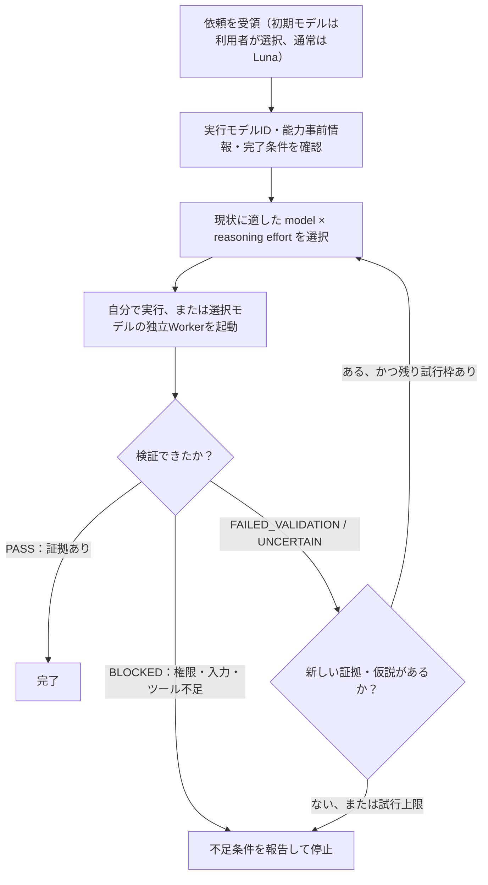

# AgentMD

OpenAI Codex で、**モデルごとの能力事前情報 + 検証結果**に基づいて、モデル・推論強度・再委譲を選ぶ実験的ルーティング設定です。

**状態（2026-11-24）：設定ファイルとベンチマーク資料は作成済み、実際のCodex上でのモデルループは未検証。** 「モデル群としての完了品質最大化」が主目的で、費用・速度・キャッシュは二次指標です。これはOpenAIの公式リポジトリではありません。

## 原則

- モデルに**固定的な職業や排他的な役割を付与しません**。Luna・Terra・Sol・Astraの全員が、タスクの内容にかかわらず実行・調査・検証の候補です。
- 各モデルは **自分の識別子を実行設定で確定し、短い能力プロファイルを読む**。モデルの自己申告や主観的な自信だけで振り分けません。
- 実行モデルと推論強度を**組み合わせて**選びます。単純な「モデルの序列」や「推論強度が高いほど常に正しい」という仮定はしません。
- 失敗・不確実性・独立検証の価値がある場合だけ次のモデルへ進み、**証拠が増えなければ終了**します。4モデルを必ず順番に回しません。
- 各Workerは独立コンテキストで作業し、親へ**検証証拠と結果の要約だけ返す**。Workerは次のモデルを提案できますが、実際の起動判断は親が行います。
- **AGENTS.mdはシステムプロンプトではありません。** Codexが読み込む指示です。TOMLの`developer_instructions`もシステムの上位制約を置き換えません。

## ファイル

```text
AgentMD/
├── AGENTS.md                         # モデルID解決・証拠ベースの遷移・停止条件
├── models/
│   ├── Luna.md                       # Lunaの能力事前情報・実行上の注意
│   ├── Terra.md                      # Terraの能力事前情報・実行上の注意
│   ├── Sol.md                        # Solの能力事前情報・実行上の注意
│   └── Astra.md                      # Astraの能力事前情報・実行上の注意
├── .codex/agents/
│   ├── agentmd_luna.toml             # Luna汎用Worker
│   ├── agentmd_terra.toml            # Terra汎用Worker
│   ├── agentmd_sol.toml              # Sol汎用Worker
│   └── agentmd_astra.toml            # Astra汎用Worker
├── research/benchmark-evidence.md    # 公開データ約40件・手法・警告・根拠
├── README.md
└── CONTRIBUTING.md
```

`research/` は調査用です。**通常のCodexタスクで読み込みません。** 実行時のコンテキストは短いモデル別Markdownだけにします。

## 静的ルーティンググラフ（状態機械）



4モデルはすべて`R`から選択でき、各Workerの結果は`V`を経由して`R`へ戻るため、**Luna → Terra → Sol → Luna**のような非単調な循環も可能です。ただし、同じ失敗条件で延々と循環しないように、上限を設けます。

### 遷移を許す理由（固定的な職務指定ではない）

| 観測した事実・前提 | 次に検討する選択 | 禁止する推論 |
| --- | --- | --- |
| タスクが小さく、現モデルで結果を検証できる | 続行して完了 | すべてに複数Workerを起動 |
| 正答が未確認で、推論余地が残る | **同モデルの強度変更**か別モデル | 自動的にlow→medium→high→…と全試行 |
| 同じ誤りが続き、別の仮説が必要 | **別のモデル・コンテキスト**で独立検証 | 同じプロンプトを無限に繰り返す |
| 視覚資料や実行ツールが必要 | 道具・入力条件を確認した上で任意の利用可能モデル | 特定のモデル名だけが操作可能と決めつける |
| 正しさの根拠が得られた | PASSで終了 | 全モデルを必ず使う |
| 必須ツール・アクセス・権限が不足 | BLOCKEDで停止 | 高性能モデルで権限不足を解決できると主張 |

初期ルールでは**1ユーザータスクにつき委譲Workerの実行は最大4回**（同じモデルの再試行も含む）。同一の`モデル + 推論強度 + 失敗証拠`の組み合わせをそのまま繰り返しません。この制約は**自然言語によるルールであり、実行基盤が強制する保証はありません**。

## 実測された初期事前情報

詳細・評価条件・欠陥警告は [benchmark-evidence.md](research/benchmark-evidence.md) に分離しました。

**Artificial Analysis Intelligence Index v5.0.1**（複数評価の合成スコア、2026-11-24確認）：

| 系列 / 使用モデル | medium | high | max |
| --- | ---: | ---: | ---: |
| Luna / `gpt-6-luna` | 18 | 21 | 28 |
| Terra / `gpt-6.1-terra` | 38 | 42 | 51 |
| Sol / `gpt-6.2-sol` | 53 | 55 | 57 |
| Astra / `gpt-6.2-astra` | 57 | 60 | 62 |

出典：[Artificial Analysis](https://artificialanalysis.ai/providers/openai/)。これらは**タスク別成功率でも、各モデルへの職務配分の証明でもありません**。推論強度を増やす場合の費用・時間も同時に測り、特定タスクで実証された結果を優先します。

補完する実コード評価として、[FrontierCode 2.0](https://cognition.com/frontiercode)（Codexハーネス、132課題、max設定）のスコアはLuna **22.7%**、Sol **43.8%**、Astra **44.2%**。Terraのこの評価の値は確認できず、**欠測であって0点ではありません**。

また、[VulcanBenchのLuna強度別実験](https://vulcanbench.com/benchmarks/swe-v4-gpt6-luna-v316.html)ではxhigh/maxで一部の課題が3時間上限に達しました。強度を上げれば必ず成功するわけではありません。DeepSWEなどの複数ベンチマークには[Epoch AIによる欠陥報告](https://epoch.ai/data/benchmark-reviews-documentation/included-benchmarks)もあります。

### 価格について

API単価はLuna $0.10/$0.50、Terra $1/$5、Sol $2/$10、Astra $8/$40（**100万入力/出力トークン当たり**、Standard）。[公式料金](https://developers.openai.com/api/docs/pricing)。**Codexのプラン内コストとは別**です。

ここではコストが安いという理由だけで実行モデルを選びません。品質が同等と確認できたときの比較材料です。

## Codexでの導入

[Codexサブエージェント公式ドキュメント](https://developers.openai.com/codex/subagents)に従い、個人共通指示と4つの汎用Worker設定をローカルに配置します。既存ファイルを上書きする前にバックアップしてください。

このリポジトリのルートで実行する例：

```sh
export CODEX_HOME="${CODEX_HOME:-$HOME/.codex}"
mkdir -p "$CODEX_HOME/models" "$CODEX_HOME/agents"
# 既存ファイル・同名TOMLのバックアップを事前に確認すること
cp AGENTS.md "$CODEX_HOME/AGENTS.md"
cp models/*.md "$CODEX_HOME/models/"
cp .codex/agents/*.toml "$CODEX_HOME/agents/"
codex --model gpt-6-luna
```

- Lunaは**起点の一案**です。グローバルモデルはユーザーが明示的に選択します。Codex公式は一般作業の起点としてSolも推奨しています。
- 4つのTOMLには**モデルIDだけを固定**し、`model_reasoning_effort` を固定していません。対応環境ではspawn時に推論強度を明示指定し、実際の選択結果を確認します。未指定の場合は親・`[agents]`設定・モデル既定値の影響を受けます。
- `models/*.md` は自動的にロードされる特別なファイルではありません。ルーター・TOMLの指示でCodexがファイル読込ツールを使う方式です。
- 同じモデルのキャッシュは一致prefixなどの条件で再利用できる可能性がありますが、異なるモデル間の共有は前提にしません。[Prompt Caching](https://developers.openai.com/api/docs/guides/prompt-caching)

## 未検証事項

このリポジトリへのファイル反映と静的な整合性検査はできますが、以下は**Codexで実測するまで保証しません**。

1. 親のLunaが対応する任意モデル・推論強度のWorkerを本当に起動できるか
2. モデル別Markdownが各Workerで正しく読み込まれるか
3. Workerが再帰的な委譲をせず、親が規定の試行上限を守るか
4. ルーティングがLuna単独・Sol単独・Astra単独より実際に成果品質を高めるか
5. キャッシュヒット、総トークン、費用、時間がどう変わるか

モデルの自己評価だけでPASSにせず、実行ログ・テスト・独立した正解判定で確認します。更新ルールは [CONTRIBUTING.md](CONTRIBUTING.md) を参照してください。
